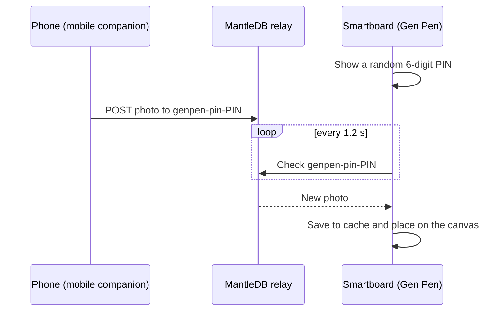

<div align="center">


# Gen Pen

**Smartboard drawing & mobile question transfer for Pardus 23 ETAP**

Draw edge-to-edge on classroom smartboards and send questions from any phone<br>
straight onto the board with a simple 6-digit PIN.

[](debian/control)
[](https://github.com/gencode3939/Gen-pen/actions/workflows/build-deb.yml)
[](https://www.pardus.org.tr/)
[](https://www.python.org/)
[](https://www.riverbankcomputing.com/software/pyqt/)
[](LICENSE)

**English** · [Türkçe](README.tr.md)

[](releases/gen-pen_2.0.0-1_all.deb?raw=true)

<br>


</div>

---

## Table of contents

- [About](#about)
- [Features](#features)
- [Screenshots](#screenshots)
- [Installation](#installation)
- [Usage](#usage)
- [Mobile companion](#mobile-companion)
- [How it works](#how-it-works)
- [Project structure](#project-structure)
- [Building the package](#building-the-package)
- [Privacy & security](#privacy--security)
- [Troubleshooting](#troubleshooting)
- [Roadmap](#roadmap)
- [Contributing](#contributing)
- [License & acknowledgements](#license--acknowledgements)

## About

**Gen Pen** is an interactive whiteboard and screen annotation application built
for the **Pardus 23 ETAP** smartboards used in Turkish classrooms (FATİH
project). It also runs on Debian 12 and Ubuntu 22.04+.

The whole screen becomes a frameless drawing canvas, and every tool lives in a
single floating dock at the bottom. A companion web app lets teachers and
students photograph a question from a textbook, crop and sharpen it on their
phone and send it to the board in seconds — no pairing, cables or app
installation required.

## Features

**Drawing**

- 🖥️ **Edge-to-edge canvas** — frameless full-screen window covering the whole display, with no title bar or panels.
- ✏️ **Tools** — pen, calligraphy pen (width reacts to drawing speed), highlighter, laser pointer (trail fades after about a second), eraser and a hand tool for moving inserted images.
- 📐 **Shapes** — line, arrow, rectangle, ellipse and triangle.
- 🎨 **Colours & width** — six quick colours, an unlimited colour picker and a 1–48 px width slider.
- ↩️ **Undo / redo** and **clear board** with confirmation.

**Boards**

- ⬜ **White board** and ⬛ **blackboard** backgrounds.
- 🔲 **Grid**, 📝 **lined** and 🎼 **music staff** overlays that work on either background.

**Floating dock**

- 🎛️ All controls in one Material 3 style dock.
- 💊 Collapses into a small **✏️ Gen Pen** pill; **long-press anywhere** (≈ 0.4 s) to bring it back with a ripple animation.
- 🚪 Touch-friendly confirmation dialogs prevent accidental exits.

**Mobile question transfer**

- 🔢 **6-digit classroom PIN** shown on the dock — a new one on every launch.
- 📱 Phone web app: camera or gallery → crop, rotate, sharpen text → send.
- ⚡ Questions appear on the board within seconds, either inserted automatically or via a notification.

**Offline-ready & integrated**

- 🔤 Google **Material Icons** font bundled — the UI needs no CDN or internet connection.
- 📦 Debian package with application menu entry, full icon set (16–512 px + SVG) and a daily automatic cleanup of received images.

## Screenshots

| Floating dock | Board templates |
| :---: | :---: |
|  |  |
| Every tool in a single dock at the bottom of the screen. | White board, blackboard, grid, lined paper and music staff. |
| **Collapsed dock** | **Exit confirmation** |
|  |  |
| Distraction-free board — long-press anywhere to reopen the dock. | Prevents closing the app by accident on a touchscreen. |

## Installation

### Requirements

| | |
| :--- | :--- |
| **Operating system** | Pardus 23 ETAP, Debian 12 (Bookworm), Ubuntu 22.04 or newer |
| **Runtime** | Python 3 and PyQt6 (installed automatically with the `.deb`) |
| **Network** | Only needed for the mobile transfer: HTTPS access to `mantledb.sh` |

### Option 1 — Debian package (recommended)

```bash
wget https://github.com/gencode3939/Gen-pen/raw/main/releases/gen-pen_2.0.0-1_all.deb
sudo apt install ./gen-pen_2.0.0-1_all.deb
```

`apt` installs all dependencies automatically. Then start Gen Pen from
**Uygulamalar → Eğitim → Gen Pen** or by running `genpen` in a terminal.

### Option 2 — Run from source

```bash
git clone https://github.com/gencode3939/Gen-pen.git
cd Gen-pen
sudo apt install python3 python3-pyqt6
python3 desktop/app/genpen_app.py
```

## Usage

Gen Pen opens in full-screen with the dock at the bottom. From left to right
the dock contains:

| Group | Controls |
| :--- | :--- |
| **Tools** | Hand · Pen · Calligraphy · Highlighter · Laser · Eraser · Shapes ▾ |
| **Style** | 6 quick colours · Colour picker · Width slider (1–48 px) |
| **Board** | Templates ▾ · Classroom PIN · Auto-insert ✨ |
| **Actions** | Undo · Redo · Clear · Full-screen · Hide dock · Exit |

| Action | Touch / mouse | Keyboard |
| :--- | :--- | :---: |
| Show the dock | Long-press the canvas (≈ 0.4 s) or tap the **✏️ Gen Pen** pill | <kbd>Esc</kbd> |
| Hide the dock | **⌄** button on the dock | <kbd>Esc</kbd> |
| Move a question image | Select the **hand tool**, then drag the image | — |
| Undo / redo | **↶** / **↷** buttons | — |
| Clear the board | **🗑** button (asks for confirmation) | — |
| Show the PIN in large type | Tap the **PIN** button | — |
| Full-screen ↔ window | **⛶** button | <kbd>F11</kbd> |
| Exit | **⏻** button (asks for confirmation) | <kbd>Ctrl</kbd> + <kbd>Q</kbd> |

## Mobile companion

The companion is a single static page in [`mobile/`](mobile/) — no app store
installation needed.

**1. Make it available to phones** — host the `mobile/` folder on any static
web host. For example, once GitHub Pages is enabled for this repository it is
available at `https://gencode3939.github.io/Gen-pen/mobile/`. For a quick test
on the local network:

```bash
python3 -m http.server 8000 --directory mobile
# then open http://<computer-ip>:8000 on the phone
```

**2. Send a question**

1. Enter the **6-digit PIN** shown on the board's dock (the phone remembers it).
2. Tap **Kamerayı Aç ve Soruyu Çek** (take a photo) or **Galeriden Soru Seç** (choose from the gallery).
3. Adjust the crop box. Use **90° Döndür** to rotate and **Netleştir (Yazı)** to make printed text clearer.
4. Tap **Tahtaya Gönder** — the question appears on the board within seconds.

> [!TIP]
> Adding `?pin=581604` to the companion URL pre-fills the PIN — handy for
> sharing a link or QR code with the class at the start of a lesson.

## How it works



The phone and the board never connect to each other directly: both talk to the
[MantleDB](https://mantledb.sh) REST API over HTTPS, so there is nothing to
pair and no shared network is needed. See
[docs/ARCHITECTURE.md](docs/ARCHITECTURE.md) for the full technical design and
[docs/PARDUS_INTEGRATION.md](docs/PARDUS_INTEGRATION.md) for system integration
details.

## Project structure

```text
Gen-pen/
├── .github/workflows/
│   └── build-deb.yml            # CI: builds the .deb, publishes releases for v* tags
├── debian/                      # Package metadata & maintainer scripts
│   ├── control
│   ├── postinst
│   └── postrm
├── desktop/                     # Smartboard application
│   ├── app/
│   │   ├── genpen_app.py        # Main PyQt6 application
│   │   └── genpen_mantle_bridge.py  # Standalone MantleDB bridge (console test tool)
│   ├── assets/
│   │   ├── fonts/               # Material Icons (TTF)
│   │   └── icons/hicolor/       # App icon: 16–512 px PNG + scalable SVG
│   ├── bin/
│   │   ├── genpen               # Launcher, installed to /usr/bin
│   │   └── genpen-cleaner.sh    # Daily cache cleanup script
│   ├── systemd/                 # User service + timer for the cleanup
│   └── genpen.desktop           # Application menu entry
├── docs/
│   ├── ARCHITECTURE.md          # Technical design
│   ├── PARDUS_INTEGRATION.md    # Installation & system integration
│   └── screenshots/
├── mobile/                      # Phone companion (static web app)
│   ├── index.html
│   ├── manifest.json
│   ├── sw.js
│   └── assets/fonts/            # Material Icons (WOFF2)
├── releases/
│   └── gen-pen_2.0.0-1_all.deb  # Pre-built package
├── build_deb.sh                 # Builds the .deb from source
├── LICENSE
├── README.md
└── README.tr.md
```

## Building the package

```bash
./build_deb.sh                    # -> releases/gen-pen_<version>_all.deb
OUTPUT_DIR=dist ./build_deb.sh    # -> custom output directory
```

The script only needs `dpkg-deb` (pre-installed on every Debian-based system).
Package name and version are read from [`debian/control`](debian/control), so a
release only requires bumping `Version:` there.

**Continuous integration** — every push and pull request to `main` builds the
package on GitHub Actions and uploads it as the `gen-pen-deb-package` artifact.
Pushing a version tag also publishes a GitHub Release with the `.deb` attached:

```bash
git tag v2.0.0
git push origin v2.0.0
```

## Privacy & security

- Photos are relayed through **MantleDB, a third-party service**, over HTTPS.
- The PIN is a **room code, not a password**: anyone who knows it can send an
  image to the board while the session is running. A new PIN is generated on
  every launch.
- Received images are stored in `~/.cache/genpen/incoming/` and deleted
  automatically after one day (when installed from the `.deb`).
- Drawings are kept in memory only and are never uploaded.
- Please do not send personal data (faces, names, student numbers) through the
  mobile transfer.

## Troubleshooting

| Problem | Solution |
| :--- | :--- |
| Icons appear as empty boxes or letters | The Material Icons font was not found. Reinstall the package, or run the source version from the repository so that `desktop/assets/fonts/` is available. |
| Questions from the phone never arrive | Check that the PIN matches (it changes on every launch) and that **both** devices can reach `https://mantledb.sh`. Filtered school networks may need to allow this domain. |
| The dock has disappeared | Long-press anywhere on the board or press <kbd>Esc</kbd>. |
| `dpkg` reports missing dependencies | Run `sudo apt-get install -f`, or install with `sudo apt install ./gen-pen_2.0.0-1_all.deb`. |
| Gen Pen is listed twice in the menu | Both `genpen.desktop` and `tr.org.genpen.desktop` are installed — a known issue (see [Roadmap](#roadmap)). |

## Roadmap

- [ ] Save and export the board (PNG / PDF)
- [ ] Stylus pressure support via `QTabletEvent`
- [ ] Honour `--mode=white` / `--mode=black` from the menu quick actions
- [ ] Keyboard shortcuts for undo / redo (<kbd>Ctrl</kbd> + <kbd>Z</kbd> / <kbd>Ctrl</kbd> + <kbd>Y</kbd>)
- [ ] Installable mobile PWA (link `manifest.json`, register `sw.js`, add app icons)
- [ ] List Gen Pen only once in application menus

## Contributing

Contributions are welcome!

1. Fork the repository and create a branch: `git checkout -b feature/my-change`
2. Make your changes — please test them on Pardus 23 or Debian 12 if possible.
3. Build and install the package to verify: `./build_deb.sh && sudo apt install ./releases/gen-pen_*.deb`
4. Open a pull request describing what you changed and why.

Bug reports and feature ideas are welcome in
[Issues](https://github.com/gencode3939/Gen-pen/issues).

## License & acknowledgements

Gen Pen is released under the **[Apache License 2.0](LICENSE)**.

- Built for the [Pardus GNU/Linux](https://www.pardus.org.tr/) ecosystem and the ETAP smartboards of the FATİH project; inspired by Pardus-Pen and ETA-Pen.
- UI icons: [Material Icons](https://fonts.google.com/icons) by Google, Apache License 2.0.
- Mobile transfer relay: [MantleDB](https://mantledb.sh).
