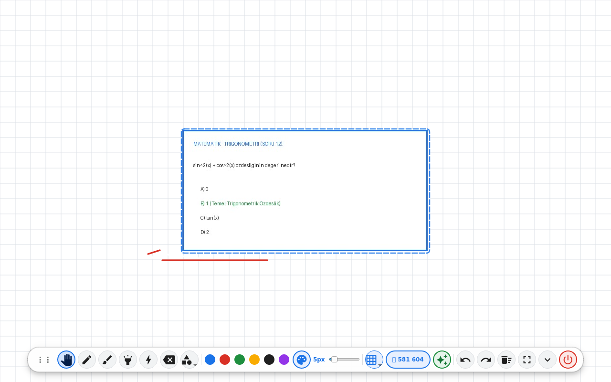
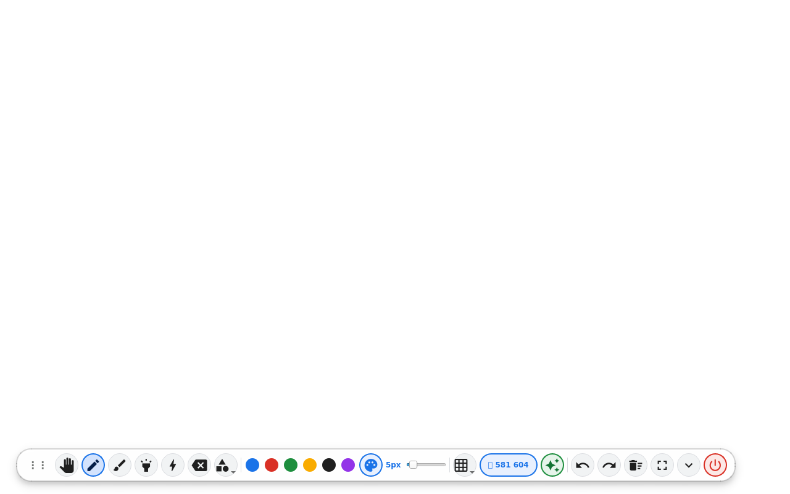
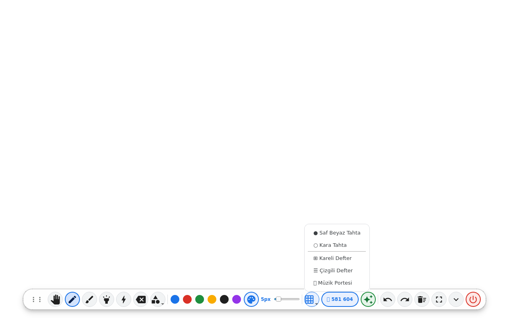
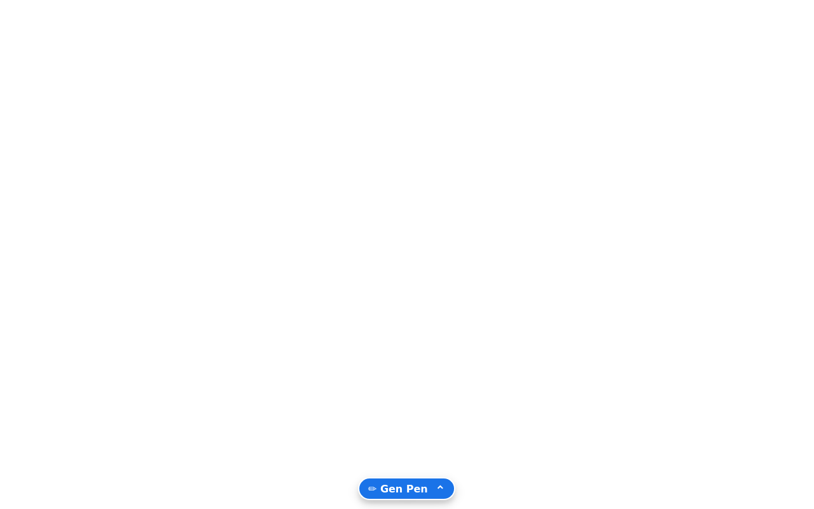
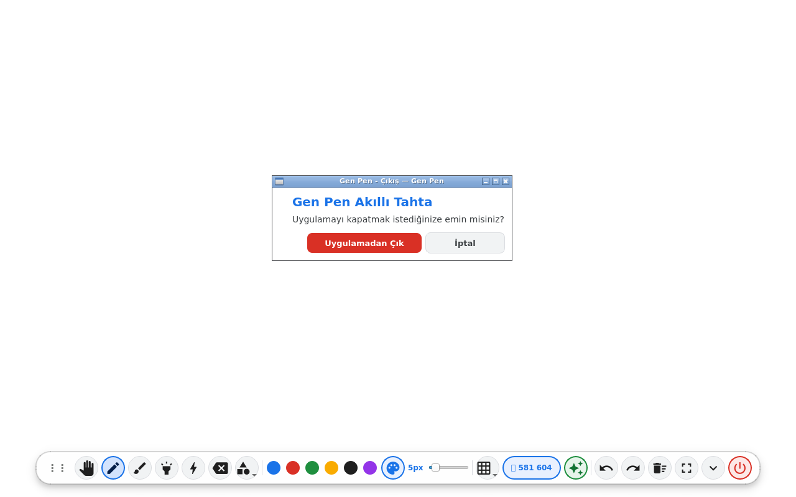
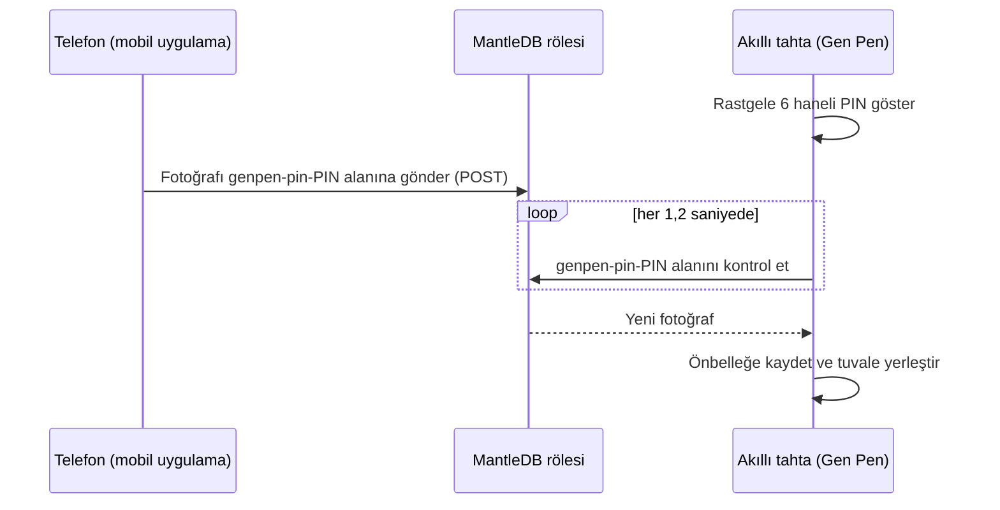

<div align="center">


# Gen Pen

**Pardus 23 ETAP için akıllı tahta çizim ve mobil soru aktarım uygulaması**

Sınıftaki akıllı tahtada kenardan kenara çizim yapın, sorularınızı herhangi bir<br>
telefondan 6 haneli PIN kodu ile saniyeler içinde tahtaya gönderin.

[](debian/control)
[](https://github.com/gencode3939/Gen-pen/actions/workflows/build-deb.yml)
[](https://www.pardus.org.tr/)
[](https://www.python.org/)
[](https://www.riverbankcomputing.com/software/pyqt/)
[](LICENSE)

[English](README.md) · **Türkçe**

[](releases/gen-pen_2.0.0-1_all.deb?raw=true)

<br>



</div>

---

## İçindekiler

- [Hakkında](#hakkında)
- [Özellikler](#özellikler)
- [Ekran görüntüleri](#ekran-görüntüleri)
- [Kurulum](#kurulum)
- [Kullanım](#kullanım)
- [Mobil uygulama](#mobil-uygulama)
- [Nasıl çalışır?](#nasıl-çalışır)
- [Proje yapısı](#proje-yapısı)
- [Paketi derleme](#paketi-derleme)
- [Gizlilik ve güvenlik](#gizlilik-ve-güvenlik)
- [Sorun giderme](#sorun-giderme)
- [Yol haritası](#yol-haritası)
- [Katkıda bulunma](#katkıda-bulunma)
- [Lisans ve teşekkürler](#lisans-ve-teşekkürler)

## Hakkında

**Gen Pen**, FATİH projesi kapsamında sınıflarda kullanılan **Pardus 23 ETAP**
akıllı tahtaları için geliştirilmiş bir etkileşimli tahta ve ekran üzerine
çizim uygulamasıdır. Debian 12 ve Ubuntu 22.04+ üzerinde de çalışır.

Ekranın tamamı çerçevesiz bir çizim tuvaline dönüşür; tüm araçlar ekranın
altındaki tek bir yüzen dock'ta toplanır. Mobil web uygulaması sayesinde
öğretmen ve öğrenciler kitaptaki bir sorunun fotoğrafını çekip telefonda
kırpabilir, netleştirebilir ve saniyeler içinde tahtaya gönderebilir —
eşleştirme, kablo ya da uygulama kurulumu gerekmez.

## Özellikler

**Çizim**

- 🖥️ **Kenardan kenara tuval** — başlık çubuğu ve paneller olmadan tüm ekranı kaplayan çerçevesiz tam ekran pencere.
- ✏️ **Araçlar** — kalem, kaligrafi kalemi (kalınlığı çizim hızına göre değişir), fosforlu kalem, lazer işaretçi (izi yaklaşık bir saniyede kaybolur), silgi ve eklenen görselleri taşımak için el aracı.
- 📐 **Şekiller** — düz çizgi, ok, dikdörtgen, elips ve üçgen.
- 🎨 **Renk ve kalınlık** — altı hızlı renk, sınırsız renk seçici ve 1–48 px kalınlık ayarı.
- ↩️ **Geri al / yinele** ve onaylı **tahtayı temizle**.

**Tahta şablonları**

- ⬜ **Beyaz tahta** ve ⬛ **kara tahta** zeminleri.
- 🔲 **Kareli**, 📝 **çizgili** ve 🎼 **müzik portesi** şablonları — her iki zeminle de kullanılabilir.

**Yüzen dock**

- 🎛️ Tüm kontroller Material 3 tasarımlı tek bir dock'ta.
- 💊 Küçük bir **✏️ Gen Pen** kapsülüne dönüşür; **ekranın herhangi bir yerine basılı tutarak** (≈ 0,4 sn) dalga animasyonuyla geri açılır.
- 🚪 Dokunmatik ekrana uygun onay pencereleri yanlışlıkla kapatmayı önler.

**Mobil soru aktarımı**

- 🔢 Dock'ta gösterilen **6 haneli sınıf PIN kodu** — her açılışta yenisi üretilir.
- 📱 Telefon uygulaması: kamera veya galeri → kırp, döndür, yazıyı netleştir → gönder.
- ⚡ Sorular saniyeler içinde tahtada belirir; otomatik olarak eklenir ya da bildirimle sunulur.

**Çevrimdışı ve sisteme entegre**

- 🔤 Google **Material Icons** yazı tipi pakete dahildir — arayüz için CDN veya internet bağlantısı gerekmez.
- 📦 Uygulama menüsü kaydı, eksiksiz simge seti (16–512 px + SVG) ve gelen görselleri her gün otomatik temizleyen hizmetle birlikte gelen Debian paketi.

## Ekran görüntüleri

| Yüzen dock | Tahta şablonları |
| :---: | :---: |
|  |  |
| Tüm araçlar ekranın altındaki tek bir dock'ta. | Beyaz tahta, kara tahta, kareli, çizgili ve müzik portesi. |
| **Gizlenmiş dock** | **Çıkış onayı** |
|  |  |
| Dikkat dağıtmayan tahta — dock'u açmak için herhangi bir yere basılı tutun. | Dokunmatik ekranda uygulamanın yanlışlıkla kapanmasını önler. |

## Kurulum

### Gereksinimler

| | |
| :--- | :--- |
| **İşletim sistemi** | Pardus 23 ETAP, Debian 12 (Bookworm), Ubuntu 22.04 veya üzeri |
| **Çalışma ortamı** | Python 3 ve PyQt6 (`.deb` ile otomatik kurulur) |
| **Ağ** | Yalnızca mobil aktarım için: `mantledb.sh` adresine HTTPS erişimi |

### Seçenek 1 — Debian paketi (önerilen)

```bash
wget https://github.com/gencode3939/Gen-pen/raw/main/releases/gen-pen_2.0.0-1_all.deb
sudo apt install ./gen-pen_2.0.0-1_all.deb
```

`apt` tüm bağımlılıkları otomatik olarak kurar. Ardından Gen Pen'i
**Uygulamalar → Eğitim → Gen Pen** menüsünden ya da terminalde `genpen`
komutuyla başlatabilirsiniz.

### Seçenek 2 — Kaynak koddan çalıştırma

```bash
git clone https://github.com/gencode3939/Gen-pen.git
cd Gen-pen
sudo apt install python3 python3-pyqt6
python3 desktop/app/genpen_app.py
```

## Kullanım

Gen Pen tam ekran açılır ve dock ekranın altında yer alır. Dock soldan sağa
şunları içerir:

| Grup | Kontroller |
| :--- | :--- |
| **Araçlar** | El · Kalem · Kaligrafi · Fosforlu kalem · Lazer · Silgi · Şekiller ▾ |
| **Stil** | 6 hızlı renk · Renk seçici · Kalınlık ayarı (1–48 px) |
| **Tahta** | Şablonlar ▾ · Sınıf PIN'i · Otomatik ekleme ✨ |
| **İşlemler** | Geri al · Yinele · Temizle · Tam ekran · Dock'u gizle · Çıkış |

| İşlem | Dokunmatik / fare | Klavye |
| :--- | :--- | :---: |
| Dock'u göster | Tuvale basılı tutun (≈ 0,4 sn) veya **✏️ Gen Pen** kapsülüne dokunun | <kbd>Esc</kbd> |
| Dock'u gizle | Dock'taki **⌄** düğmesi | <kbd>Esc</kbd> |
| Soru görselini taşı | **El aracını** seçip görseli sürükleyin | — |
| Geri al / yinele | **↶** / **↷** düğmeleri | — |
| Tahtayı temizle | **🗑** düğmesi (onay ister) | — |
| PIN'i büyük göster | **PIN** düğmesine dokunun | — |
| Tam ekran ↔ pencere | **⛶** düğmesi | <kbd>F11</kbd> |
| Çıkış | **⏻** düğmesi (onay ister) | <kbd>Ctrl</kbd> + <kbd>Q</kbd> |

## Mobil uygulama

Mobil uygulama, [`mobile/`](mobile/) klasöründeki tek bir statik sayfadır —
uygulama mağazasından kurulum gerektirmez.

**1. Telefonların erişimine açın** — `mobile/` klasörünü herhangi bir statik
web sunucusunda yayınlayın. Örneğin bu depo için GitHub Pages
etkinleştirildiğinde uygulama `https://gencode3939.github.io/Gen-pen/mobile/`
adresinden açılır. Yerel ağda hızlıca denemek için:

```bash
python3 -m http.server 8000 --directory mobile
# ardından telefonda http://<bilgisayar-ip-adresi>:8000 adresini açın
```

**2. Soru gönderin**

1. Tahtadaki dock'ta görünen **6 haneli PIN kodunu** girin (telefon bunu hatırlar).
2. **Kamerayı Aç ve Soruyu Çek** ya da **Galeriden Soru Seç** düğmesine dokunun.
3. Kırpma kutusunu ayarlayın. Döndürmek için **90° Döndür**, basılı yazıyı belirginleştirmek için **Netleştir (Yazı)** düğmesini kullanın.
4. **Tahtaya Gönder** düğmesine dokunun — soru saniyeler içinde tahtada belirir.

> [!TIP]
> Uygulama adresinin sonuna `?pin=581604` eklerseniz PIN kodu otomatik
> doldurulur. Ders başında sınıfla bağlantı veya QR kod paylaşmak için idealdir.

## Nasıl çalışır?



Telefon ve tahta birbirine doğrudan bağlanmaz: ikisi de HTTPS üzerinden
[MantleDB](https://mantledb.sh) REST API'si ile konuşur. Bu yüzden eşleştirme
yapmak ya da aynı ağda bulunmak gerekmez. Ayrıntılı teknik tasarım için
[docs/ARCHITECTURE.md](docs/ARCHITECTURE.md), sistem entegrasyonu için
[docs/PARDUS_INTEGRATION.md](docs/PARDUS_INTEGRATION.md) belgelerine bakın
(İngilizce).

## Proje yapısı

```text
Gen-pen/
├── .github/workflows/
│   └── build-deb.yml            # CI: .deb paketini derler, v* etiketlerinde sürüm yayınlar
├── debian/                      # Paket bilgileri ve kurulum betikleri
│   ├── control
│   ├── postinst
│   └── postrm
├── desktop/                     # Akıllı tahta uygulaması
│   ├── app/
│   │   ├── genpen_app.py        # Ana PyQt6 uygulaması
│   │   └── genpen_mantle_bridge.py  # Bağımsız MantleDB köprüsü (konsol test aracı)
│   ├── assets/
│   │   ├── fonts/               # Material Icons (TTF)
│   │   └── icons/hicolor/       # Uygulama simgesi: 16–512 px PNG + SVG
│   ├── bin/
│   │   ├── genpen               # Başlatıcı, /usr/bin altına kurulur
│   │   └── genpen-cleaner.sh    # Günlük önbellek temizleme betiği
│   ├── systemd/                 # Temizlik için kullanıcı servisi ve zamanlayıcısı
│   └── genpen.desktop           # Uygulama menüsü kaydı
├── docs/
│   ├── ARCHITECTURE.md          # Teknik tasarım
│   ├── PARDUS_INTEGRATION.md    # Kurulum ve sistem entegrasyonu
│   └── screenshots/
├── mobile/                      # Telefon uygulaması (statik web uygulaması)
│   ├── index.html
│   ├── manifest.json
│   ├── sw.js
│   └── assets/fonts/            # Material Icons (WOFF2)
├── releases/
│   └── gen-pen_2.0.0-1_all.deb  # Hazır derlenmiş paket
├── build_deb.sh                 # Kaynaktan .deb paketi derler
├── LICENSE
├── README.md
└── README.tr.md
```

## Paketi derleme

```bash
./build_deb.sh                    # -> releases/gen-pen_<sürüm>_all.deb
OUTPUT_DIR=dist ./build_deb.sh    # -> farklı bir çıktı klasörü
```

Betik yalnızca `dpkg-deb` aracına ihtiyaç duyar (tüm Debian tabanlı
sistemlerde yüklü gelir). Paket adı ve sürümü
[`debian/control`](debian/control) dosyasından okunur; yeni sürüm için yalnızca
oradaki `Version:` satırını güncellemek yeterlidir.

**Sürekli entegrasyon** — `main` dalına yapılan her push ve pull request'te
paket GitHub Actions üzerinde derlenir ve `gen-pen-deb-package` adıyla
yüklenir. Bir sürüm etiketi gönderildiğinde `.deb` dosyası eklenmiş bir GitHub
Release da otomatik olarak yayınlanır:

```bash
git tag v2.0.0
git push origin v2.0.0
```

## Gizlilik ve güvenlik

- Fotoğraflar, **üçüncü taraf bir hizmet olan MantleDB** üzerinden HTTPS ile aktarılır.
- PIN kodu bir **parola değil, oda kodudur**: oturum açıkken kodu bilen herkes
  tahtaya görsel gönderebilir. Her açılışta yeni bir PIN üretilir.
- Gelen görseller `~/.cache/genpen/incoming/` klasöründe saklanır ve (`.deb`
  ile kurulduğunda) bir gün sonra otomatik olarak silinir.
- Çizimler yalnızca bellekte tutulur, hiçbir yere yüklenmez.
- Lütfen mobil aktarım ile kişisel veri (yüz, ad-soyad, öğrenci numarası)
  göndermeyin.

## Sorun giderme

| Sorun | Çözüm |
| :--- | :--- |
| Simgeler boş kutu veya harf olarak görünüyor | Material Icons yazı tipi bulunamadı. Paketi yeniden kurun ya da kaynak sürümü `desktop/assets/fonts/` klasörü erişilebilir olacak şekilde depo içinden çalıştırın. |
| Telefondan gönderilen sorular gelmiyor | PIN kodunun eşleştiğini (her açılışta değişir) ve **her iki** cihazın da `https://mantledb.sh` adresine erişebildiğini kontrol edin. Filtreli okul ağlarında bu alan adına izin verilmesi gerekebilir. |
| Dock kayboldu | Tahtada herhangi bir yere basılı tutun veya <kbd>Esc</kbd> tuşuna basın. |
| `dpkg` eksik bağımlılık hatası veriyor | `sudo apt-get install -f` komutunu çalıştırın ya da paketi `sudo apt install ./gen-pen_2.0.0-1_all.deb` ile kurun. |
| Gen Pen menüde iki kez görünüyor | `genpen.desktop` ve `tr.org.genpen.desktop` birlikte kuruluyor — bilinen bir sorundur (bkz. [Yol haritası](#yol-haritası)). |

## Yol haritası

- [ ] Tahtayı kaydetme ve dışa aktarma (PNG / PDF)
- [ ] `QTabletEvent` ile kalem basıncı desteği
- [ ] Menü kısayollarındaki `--mode=white` / `--mode=black` seçeneklerinin uygulanması
- [ ] Geri al / yinele için klavye kısayolları (<kbd>Ctrl</kbd> + <kbd>Z</kbd> / <kbd>Ctrl</kbd> + <kbd>Y</kbd>)
- [ ] Kurulabilir mobil PWA (`manifest.json` bağlantısı, `sw.js` kaydı, uygulama simgeleri)
- [ ] Gen Pen'in uygulama menülerinde yalnızca bir kez listelenmesi

## Katkıda bulunma

Katkılarınızı bekliyoruz!

1. Depoyu fork'layın ve yeni bir dal oluşturun: `git checkout -b ozellik/degisikligim`
2. Değişikliklerinizi yapın — mümkünse Pardus 23 veya Debian 12 üzerinde test edin.
3. Doğrulamak için paketi derleyip kurun: `./build_deb.sh && sudo apt install ./releases/gen-pen_*.deb`
4. Neyi neden değiştirdiğinizi açıklayan bir pull request açın.

Hata bildirimleri ve özellik önerileri için
[Issues](https://github.com/gencode3939/Gen-pen/issues) sayfasını kullanabilirsiniz.

## Lisans ve teşekkürler

Gen Pen, **[Apache Lisansı 2.0](LICENSE)** ile yayınlanmaktadır.

- [Pardus GNU/Linux](https://www.pardus.org.tr/) ekosistemi ve FATİH projesinin ETAP akıllı tahtaları için geliştirilmiştir; Pardus-Pen ve ETA-Pen'den ilham alınmıştır.
- Arayüz simgeleri: Google'ın [Material Icons](https://fonts.google.com/icons) koleksiyonu, Apache Lisansı 2.0.
- Mobil aktarım rölesi: [MantleDB](https://mantledb.sh).
