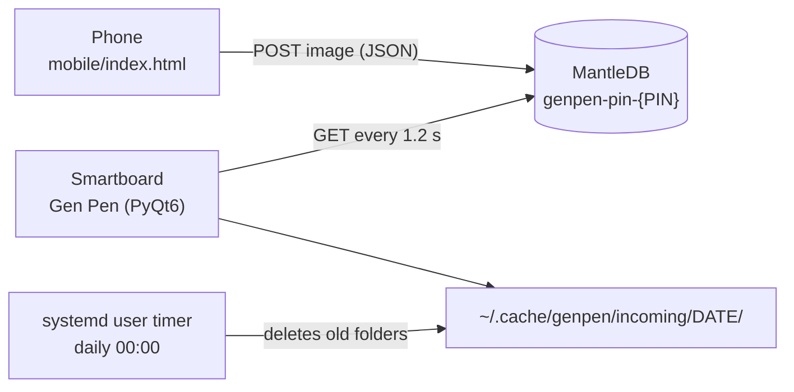
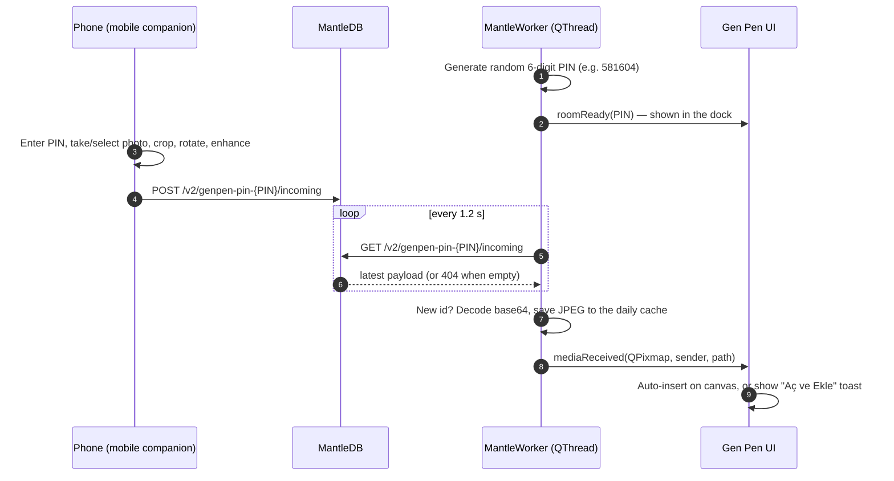

# Gen Pen — Technical Architecture

This document describes how Gen Pen is put together: its components, the
mobile-to-smartboard transfer pipeline, the internals of the desktop
application and the files it creates at runtime.

- [1. Components](#1-components)
- [2. Question transfer pipeline](#2-question-transfer-pipeline)
- [3. Desktop application internals](#3-desktop-application-internals)
- [4. Mobile companion](#4-mobile-companion)
- [5. Local storage & cleanup](#5-local-storage--cleanup)
- [6. Offline assets](#6-offline-assets)
- [7. Standalone MantleDB bridge](#7-standalone-mantledb-bridge)
- [8. Security considerations](#8-security-considerations)

---

## 1. Components

| Component | Location | Technology | Runs on |
| :--- | :--- | :--- | :--- |
| **Desktop smartboard client** | [`desktop/app/genpen_app.py`](../desktop/app/genpen_app.py) | Python 3, PyQt6 | Pardus 23 ETAP, Debian 12, Ubuntu 22.04+ |
| **Mobile companion** | [`mobile/index.html`](../mobile/index.html) | Single-file HTML/CSS/JS | Any modern mobile browser |
| **Relay** | `https://mantledb.sh/v2` | MantleDB REST API (third-party) | Cloud |
| **Cache cleaner** | [`desktop/bin/genpen-cleaner.sh`](../desktop/bin/genpen-cleaner.sh) + [`desktop/systemd/`](../desktop/systemd/) | Bash, systemd user timer | Smartboard |

The phone and the smartboard never talk to each other directly. Both only make
outbound HTTPS requests to MantleDB, so no pairing, Bluetooth or shared local
network is required.



## 2. Question transfer pipeline



### 2.1 Smartboard side (`MantleWorker`)

1. On start-up a random PIN in the range `100000–999999` is generated and the
   namespace `genpen-pin-{PIN}` is derived from it. A new PIN is generated on
   every launch.
2. The PIN and namespace are written to
   `~/.cache/genpen/incoming/<YYYY-MM-DD>/current_session.json`.
3. A background `QThread` polls
   `GET https://mantledb.sh/v2/genpen-pin-{PIN}/incoming` every **1.2 s**
   (4 s request timeout). Network and HTTP errors are ignored silently, so the
   board keeps working offline.
4. A payload is considered new when its `id` (or `timestamp`) differs from the
   last one processed.
5. The `data` field is decoded (an optional `data:image/...;base64,` prefix is
   stripped), loaded into a `QPixmap` and saved as `img_<HHMMSS>_<id>.jpg` in
   the daily cache folder.
6. `mediaReceived(QPixmap, sender, path)` is emitted to the UI thread.

### 2.2 Placement on the canvas

| Auto-insert toggle (✨ in the dock) | Behaviour |
| :--- | :--- |
| **On** (default) | The image is inserted immediately and a toast is shown for 4 seconds. |
| **Off** | Only a toast is shown; tapping **Aç ve Ekle** inserts the image. |

Inserted images are centred and scaled down (keeping the aspect ratio) to fit
within 75 % of the canvas width and height. They can be repositioned with the
Hand (pan) tool, which also outlines them with a dashed frame.

### 2.3 Payload format

Sent by the mobile companion as `Content-Type: application/json`:

```json
{
  "id": "mob_1739871234567",
  "sender": "Öğrenci / Mobil Telefon",
  "timestamp": 1739871234567,
  "data": "data:image/jpeg;base64,/9j/4AAQSkZJRgABAQ..."
}
```

| Field | Type | Description |
| :--- | :--- | :--- |
| `id` | string | Unique message id (`mob_` + epoch milliseconds); used for de-duplication. |
| `sender` | string | Display name shown in the notification toast. |
| `timestamp` | number | Epoch milliseconds; fallback id when `id` is missing. |
| `data` | string | JPEG image (quality 0.85) as a base64 data URL. |

## 3. Desktop application internals

All desktop code lives in a single module, `genpen_app.py`:

| Class / function | Responsibility |
| :--- | :--- |
| `load_material_font()` | Registers the bundled Material Icons font (see [§6](#6-offline-assets)). |
| `MaterialIconButton` | Round, checkable Material 3 style icon button used throughout the dock. |
| `MantleWorker` | Background `QThread`: PIN generation, polling, decoding and caching (see [§2.1](#21-smartboard-side-mantleworker)). |
| `GenCanvas` | Drawing surface: stroke model, tools, rendering, board templates, long-press detection. |
| `GenDock` | Floating bottom dock holding every control; animated collapse/expand. |
| `GenNotificationToast` | "Yeni Soru Geldi!" notification with thumbnail and **Aç ve Ekle** button. |
| `PinDialog` | Large, readable PIN display for the classroom. |
| `GenMainWindow` | Frameless full-screen window that wires everything together; keyboard shortcuts. |
| `main()` | Creates the `QApplication`, loads the font and shows the window full-screen. |

### 3.1 Window

`GenMainWindow` uses `Qt.WindowType.FramelessWindowHint`, takes the geometry
of the primary screen and is shown with `showFullScreen()`, so the canvas covers
the entire display. Toggling full-screen off (F11 or the dock button) switches
to a 1280 × 800 window.

### 3.2 Canvas model

The canvas keeps three lists: `strokes`, `undone_strokes` (redo stack) and
`images`. Every new stroke clears the redo stack; **Clear** (with confirmation)
empties all three.

- **Freehand strokes** store their points together with a per-point width:
  `{"type": "freehand", "points": [...], "color", "base_width", "tool"}`.
- **Shapes** store two corner points:
  `{"type": "shape", "shape": "line|arrow|rect|circle|triangle", "start", "end", "color", "width"}`.

### 3.3 Tools and stroke width

| Tool | Rendering |
| :--- | :--- |
| Pen | `base × (0.4 + 0.6 · p^1.2)` |
| Calligraphy | `base × 1.5 × (0.2 + 0.8 · p^1.5) × (1 − 0.2 · min(1, v / 1200))` — thins out with drawing speed `v` |
| Highlighter | `max(20, 3.5 × base)` with 35 % opacity (alpha 90) |
| Eraser | Paints over strokes with the board colour |
| Laser | Red dots that fade out over 1.2 s (refreshed every 45 ms); never stored |
| Shapes | Line, arrow (filled head), rounded rectangle, ellipse, triangle |

`base` is the slider value (1–48 px). Input currently arrives through mouse and
synthesised touch events with a constant pressure `p = 0.5`; reading real stylus
pressure through `QTabletEvent` is on the roadmap.

Segments are drawn individually with round caps and joins, which keeps strokes
smooth at any width.

### 3.4 Board templates

| Template | Implementation |
| :--- | :--- |
| White board | Background `#FFFFFF` |
| Blackboard | Background `#1E1E1E` |
| Grid notebook | 32 px squares (overlay) |
| Lined notebook | Horizontal lines every 36 px (overlay) |
| Music staff | Groups of 5 lines, 12 px apart, 60 px between staves (overlay) |

Overlays are toggled independently of the background, so every overlay works
on both the white board and the blackboard.

### 3.5 Dock and long-press

- `GenDock` animates its `pos` property with a 260 ms `QPropertyAnimation`
  using `QEasingCurve.Type.OutCubic`. Collapsing replaces the full dock with a
  compact **✏️ Gen Pen ⌃** pill.
- `GenCanvas` starts a 380 ms single-shot timer on every left press. Moving more
  than 8 px or releasing earlier cancels it. When it fires, the current stroke
  is discarded, a blue ripple is drawn at the touch point and
  `longPressTriggered` makes the main window slide the dock back up.

### 3.6 Keyboard shortcuts

| Key | Action |
| :--- | :--- |
| <kbd>Esc</kbd> | Collapse / expand the dock |
| <kbd>F11</kbd> | Toggle full-screen |
| <kbd>Ctrl</kbd> + <kbd>Q</kbd> | Exit (with confirmation) |

## 4. Mobile companion

`mobile/index.html` is a self-contained page (Turkish UI) with three steps:

1. **PIN & capture** — the 6-digit PIN is stored in `localStorage`
   (`genpen_pin`) and can be pre-filled with `?pin=123456` or `#pin=123456`.
   Photos come from the camera (`capture="environment"`) or the gallery.
2. **Crop & enhance** — draggable crop box, 90° rotation and a contrast
   boost (**Netleştir (Yazı)**) that makes printed text easier to read.
3. **Send** — the cropped image is encoded as JPEG and posted to MantleDB
   (see [§2.3](#23-payload-format)); a success screen offers the next question.

`mobile/manifest.json` and `mobile/sw.js` (cache-first service worker) are
included for Progressive Web App support but are not yet referenced from
`index.html`. The manifest also expects `assets/icons/icon-192.png` and
`assets/icons/icon-512.png`, which still need to be added.

## 5. Local storage & cleanup

| Path | Content |
| :--- | :--- |
| `~/.cache/genpen/incoming/<YYYY-MM-DD>/` | Received images (`img_<HHMMSS>_<id>.jpg`) |
| `~/.cache/genpen/incoming/<YYYY-MM-DD>/current_session.json` | Active PIN and namespace |

The `genpen-cleaner.timer` systemd **user** timer fires every day at 00:00
(`Persistent=true`, so a missed run is caught up at the next login) and starts
`genpen-cleaner.service`, which runs `/usr/lib/genpen/genpen-cleaner.sh`. The
script deletes day folders older than 24 hours and logs to the journal with the
tag `genpen-cleaner`.

Drawings themselves are kept in memory only and are not saved to disk.

## 6. Offline assets

The UI icons are glyphs from Google's Material Icons font, so no icon CDN is
needed. `load_material_font()` uses the first file that exists:

1. `/usr/lib/genpen/assets/fonts/MaterialIcons-Regular.ttf` — installed by the `.deb`
2. `/usr/share/fonts/truetype/material-design-icons-iconfont/MaterialIcons-Regular.ttf`
3. `/usr/share/fonts/truetype/material-icons/MaterialIcons-Regular.ttf`
4. `<module dir>/assets/fonts/MaterialIcons-Regular.ttf`
5. `<module dir>/../assets/fonts/MaterialIcons-Regular.ttf` — running from a source checkout

The mobile companion embeds the WOFF2 version of the font inline (base64) in
`index.html`; `mobile/assets/fonts/MaterialIcons-Regular.woff2` is the
standalone copy referenced by the service worker.

## 7. Standalone MantleDB bridge

[`desktop/app/genpen_mantle_bridge.py`](../desktop/app/genpen_mantle_bridge.py)
is a console tool for testing the MantleDB integration. It is **not** used by
the GUI or the mobile companion. Unlike `MantleWorker`, it:

- claims its own namespace (`genpen-<n>`) through `GET /v2/claim/{room}` and
  authenticates subsequent polls with the returned `X-Mantle-Key`,
- prints a connection URL / JSON payload that could be encoded as a QR code,
- saves incoming images to the same daily cache and purges folders older than
  24 hours on start-up.

```bash
python3 desktop/app/genpen_mantle_bridge.py   # stop with Ctrl+C
```

## 8. Security considerations

- Images are relayed through **MantleDB, a third-party service**, over HTTPS.
- The GUI and the mobile companion use the unclaimed namespace
  `genpen-pin-{PIN}` without an API key. The PIN is therefore a **room code,
  not a password**: anyone who knows it can send images to the board or read
  the latest one while the session is active.
- A new PIN is generated on every launch. When Gen Pen is installed from the
  `.deb` package, received images are deleted from the smartboard
  automatically after one day.
- Avoid sending personal data (faces, names, student numbers) through the
  relay.
